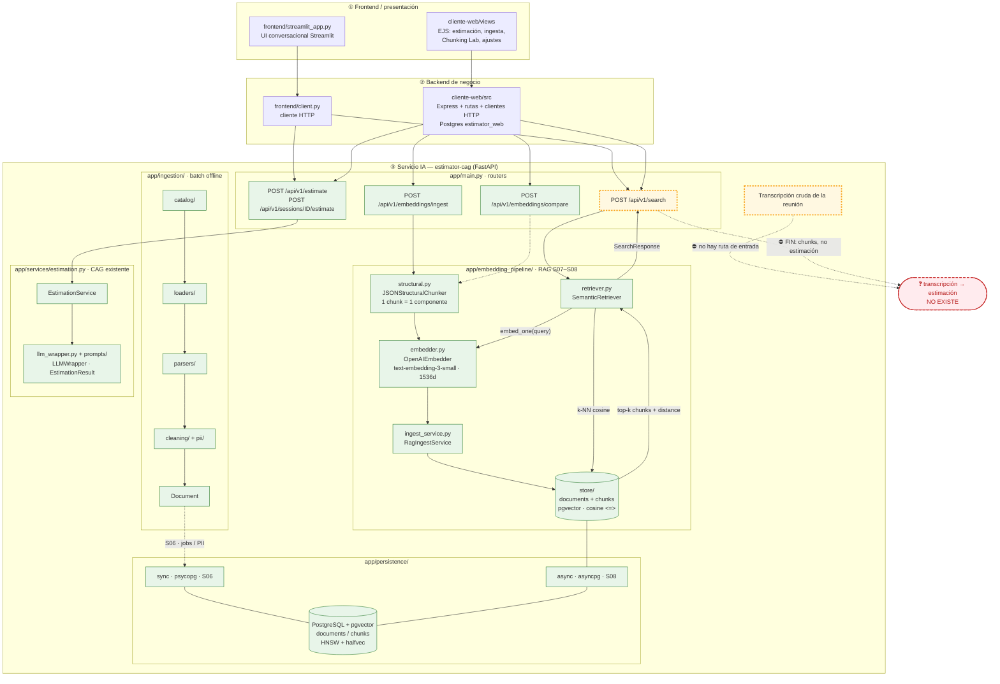
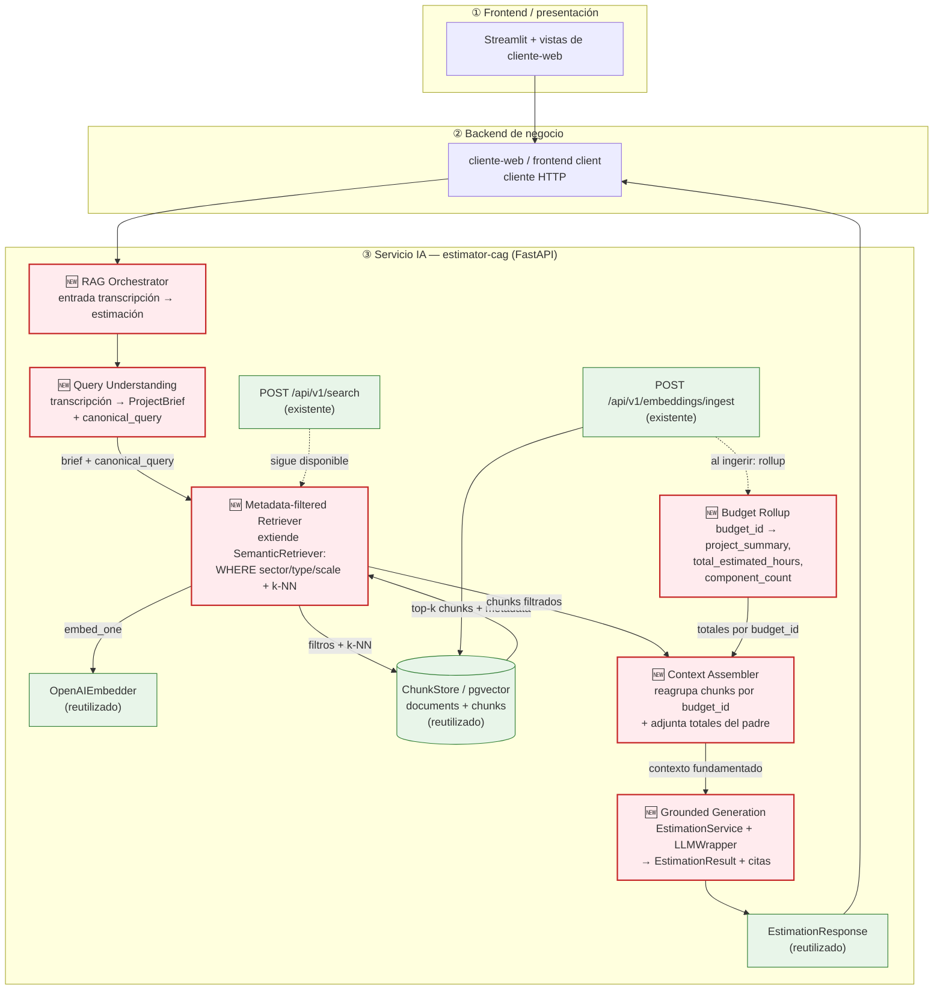

# Diagnóstico arquitectónico — Sesión 09 (pre-work)

Estado del servicio IA `estimator-cag` al cierre de la Sesión 08, comportamiento observado al
pasarle una transcripción cruda, fallos concretos y propuesta de evolución hasta cerrar el bucle
transcripción → estimación.

> **Cómo está escrito este documento.** Las observaciones van en español; los comandos, payloads y
> nombres de campo van en inglés. El trace de la sección 2 es reproducible: los comandos están
> puestos tal cual se ejecutan y la salida real está pegada en los bloques de respuesta.

> **Nota de fidelidad.** El enunciado describe el servicio IA con nombres genéricos (`ingest/`,
> `embedding_pipeline/`, `storage/`). El repo real los implementa así: `app/ingestion/` para la
> ingesta batch offline, `app/embedding_pipeline/` para chunking, embeddings, ingest y retrieval, y
> `app/embedding_pipeline/store/` para el acceso a pgvector. Este documento describe la arquitectura
> **real** de este repo, no la del enunciado.

---

## 1. Diagrama de la arquitectura actual (cierre S08)

Tres capas. El servicio IA está bajado un nivel. El borde amarillo marca el último eslabón vivo:
`/api/v1/search` devuelve chunks con distancias, no una estimación. La caja roja no existe en
ninguna forma. La estimación CAG (verde) sí existe, pero vive en un camino separado: no recibe los
chunks recuperados.



**Lectura del diagrama.** Lo implementado (verde) cubre dos caminos. El primero es la **ingesta**:
`/embeddings/ingest` recibe un presupuesto, `JSONStructuralChunker` lo parte en un chunk por
componente, `OpenAIEmbedder` los vectoriza y `RagIngestService` los persiste en `documents` /
`chunks` (pgvector). El segundo es la **búsqueda**: `/search` embebe la query con el mismo modelo y
`SemanticRetriever` pide los `k` chunks más cercanos por coseno. El borde amarillo (`/search`) es el
último eslabón vivo: **devuelve una lista de chunks con distancias, no una estimación**. El camino
CAG (`EstimationService` → `LLMWrapper` → `EstimationResult`) también funciona, pero está aislado:
no consume los chunks recuperados ni recibe una transcripción. La caja roja es el hueco exacto que
abre la Sesión 09.

La ingesta batch de `app/ingestion/` es otro camino distinto: transforma fuentes del catálogo en
`Document` y registra jobs/PII en el stack sync de la Sesión 06. No es la ingesta de presupuestos
históricos del RAG; son dos pipelines con propósitos diferentes.

---

## 2. Trace anotado de `02_ambiguous.txt`

Cliente: Ultramarinos La Plazuela, tienda gourmet física que quiere “vender por internet”, “algo de
fidelización / puntos”, “un panel para ver pedidos y stock”, “pagar con tarjeta” y “un correo al
comprar”. Divaga, mezcla temas y solo un par de frases dan pistas concretas.

**Preparación (una vez):**

```bash
cd estimador-cag
docker compose up -d --build
curl -s http://localhost:8000/health | jq

docker compose exec estimator-postgres psql -U estimator -d estimator \
  -c "SELECT count(*) AS documents FROM documents;" \
  -c "SELECT count(*) AS chunks FROM chunks;"

docker compose run --rm api python scripts/query_examples.py
```

El corpus canónico son **17 presupuestos / 60 chunks**. El script de ejemplo es idempotente: los
documentos ya ingeridos responden `409`, así que reejecutarlo no duplica. La evidencia completa del
trace queda también en `data/output/session09/trace_02_ambiguous.txt`.

**Trace (script cliente, no añade comportamiento al servicio):**

```bash
export OPENAI_API_KEY="sk-..."   # o export OPEN_AI_KEY="sk-..."
uv run examples/trace_s09.py examples/transcripts/02_ambiguous.txt
```

### Paso 1 — Embeber la transcripción completa

El script embebe el texto completo con `text-embedding-3-small` (1536 dims), el mismo modelo que el
servicio usa en la ingesta. No hay endpoint que devuelva el vector crudo: embeber ocurre *dentro*
de `/search`; por eso se hace explícito en el script.

```text
transcript      : examples/transcripts/02_ambiguous.txt
model           : text-embedding-3-small
characters      : 2813
dimensionality  : 1536
L2 norm         : 0.999817
first component : 0.006599
last component  : 0.019318
```

> **Comentario.** Un único vector de 1536 dimensiones resume **toda** la transcripción: la tienda
> física, la fidelización, el panel, el pago, el correo, la anécdota del primo en Francia y el ruido
> conversacional. Es la media semántica de varias intenciones distintas: no representa “lo que el
> cliente quiere construir”, representa “de qué se habló en la reunión”. La norma ≈ 1.0 confirma que
> OpenAI normaliza el vector, así que la distancia coseno es directamente comparable.

### Paso 2 — Búsqueda semántica (`POST /api/v1/search`, k=5)

El script reembebe el mismo texto y pide los cinco chunks más cercanos por distancia coseno (menor =
más parecido). Equivalente en `curl`:

```bash
curl -s -X POST http://localhost:8000/api/v1/search \
  -H "Content-Type: application/json" \
  --data-binary "$(jq -Rs '{query: ., k: 5}' examples/transcripts/02_ambiguous.txt)" | jq
```

Respuesta real. Se abrevia el campo `query` por legibilidad; el resto es literal:

```json
{
  "query": "Reunión exploratoria — ... (2813 caracteres; ver examples/transcripts/02_ambiguous.txt)",
  "k": 5,
  "search_time_ms": 556,
  "results": [
    {
      "chunk_id": 17,
      "document_id": 5,
      "chunk_type": "budget_component",
      "content": "[Project: Headless e-commerce storefront with personalized recommendations]\n[Client sector: ecommerce | Year: 2024 | Main tech: node]\n\nComponent: Cart and checkout service\nDescription: Stateless cart service with promotion engine, tax calculation and a checkout orchestration that integrates the payment provider.\nTech stack: node, redis, postgresql\nComplexity: high\nEstimated hours: 140",
      "distance": 0.6109539013398573,
      "metadata": {
        "year": 2024,
        "budget_id": "BUD-2024-005",
        "complexity": "high",
        "component_id": "CART-002",
        "client_sector": "ecommerce",
        "estimated_hours": 140,
        "main_technology": "node"
      }
    },
    {
      "chunk_id": 16,
      "document_id": 5,
      "chunk_type": "budget_component",
      "content": "[Project: Headless e-commerce storefront with personalized recommendations]\n[Client sector: ecommerce | Year: 2024 | Main tech: node]\n\nComponent: Product catalog API\nDescription: GraphQL catalog API with faceted search, inventory availability and multi-currency pricing backed by Elasticsearch.\nTech stack: node, graphql, elasticsearch\nComplexity: medium\nEstimated hours: 150",
      "distance": 0.6112637500742237,
      "metadata": {
        "year": 2024,
        "budget_id": "BUD-2024-005",
        "complexity": "medium",
        "component_id": "CATALOG-001",
        "client_sector": "ecommerce",
        "estimated_hours": 150,
        "main_technology": "node"
      }
    },
    {
      "chunk_id": 18,
      "document_id": 5,
      "chunk_type": "budget_component",
      "content": "[Project: Headless e-commerce storefront with personalized recommendations]\n[Client sector: ecommerce | Year: 2024 | Main tech: node]\n\nComponent: Personalized recommendations\nDescription: Collaborative-filtering recommendations served from a feature store and exposed as a low-latency API for product and cart pages.\nTech stack: node, redis\nComplexity: medium\nEstimated hours: 110",
      "distance": 0.6337974829718546,
      "metadata": {
        "year": 2024,
        "budget_id": "BUD-2024-005",
        "complexity": "medium",
        "component_id": "RECO-003",
        "client_sector": "ecommerce",
        "estimated_hours": 110,
        "main_technology": "node"
      }
    },
    {
      "chunk_id": 19,
      "document_id": 5,
      "chunk_type": "budget_component",
      "content": "[Project: Headless e-commerce storefront with personalized recommendations]\n[Client sector: ecommerce | Year: 2024 | Main tech: node]\n\nComponent: Storefront PWA\nDescription: Progressive web app storefront consuming the headless APIs with server-side rendering for SEO.\nTech stack: next_js, react\nComplexity: low\nEstimated hours: 60",
      "distance": 0.6368338148364694,
      "metadata": {
        "year": 2024,
        "budget_id": "BUD-2024-005",
        "complexity": "low",
        "component_id": "STORE-004",
        "client_sector": "ecommerce",
        "estimated_hours": 60,
        "main_technology": "node"
      }
    },
    {
      "chunk_id": 27,
      "document_id": 8,
      "chunk_type": "budget_component",
      "content": "[Project: Fashion returns management and resale portal]\n[Client sector: ecommerce | Year: 2023 | Main tech: dotnet]\n\nComponent: Returns portal\nDescription: Self-service returns portal with label generation, reason capture and automatic restock or resale routing.\nTech stack: dotnet, sqlserver\nComplexity: medium\nEstimated hours: 140",
      "distance": 0.6430103802568091,
      "metadata": {
        "year": 2023,
        "budget_id": "BUD-2024-008",
        "complexity": "medium",
        "component_id": "RET-001",
        "client_sector": "ecommerce",
        "estimated_hours": 140,
        "main_technology": "dotnet"
      }
    }
  ]
}
```

### Paso 3 — Lectura de los chunks devueltos

| # | chunk / componente | presupuesto / sector | distancia | ¿Relevante para el cliente? |
|---|--------------------|----------------------|-----------|------------------------------|
| 1 | `CART-002` · Cart and checkout service · 140 h | `BUD-2024-005` / ecommerce | 0.6110 | **Sí, parcial.** Checkout y pago encajan con “pagar con tarjeta”, pero es una plataforma headless de 460 h, mucho mayor que su tienda. |
| 2 | `CATALOG-001` · Product catalog API · 150 h | `BUD-2024-005` / ecommerce | 0.6113 | **Parcial.** El catálogo encaja, pero GraphQL + Elasticsearch es sobredimensionado para un negocio que hoy lleva el stock en un cuaderno. |
| 3 | `RECO-003` · Personalized recommendations · 110 h | `BUD-2024-005` / ecommerce | 0.6338 | **No.** No ha pedido recomendaciones personalizadas; entra por pertenecer al mismo presupuesto ecommerce. |
| 4 | `STORE-004` · Storefront PWA · 60 h | `BUD-2024-005` / ecommerce | 0.6368 | **Parcial.** Storefront encaja; PWA con SSR es más de lo que necesita para empezar. |
| 5 | `RET-001` · Returns portal · 140 h | `BUD-2024-008` / ecommerce | 0.6430 | **No.** No ha pedido devoluciones; es un falso positivo por dominio ecommerce. |

> **Comentario honesto.** El resultado es **mediocre y revelador**. Los cinco chunks caen en una
> banda de `0.6110–0.6430` (Δ ≈ 0.032): el sistema no tiene una opinión fuerte porque la query es la
> media de muchas intenciones. Cuatro de los cinco son del **mismo presupuesto**
> (`BUD-2024-005`, 460 h), que es sobredimensionado para una tienda gourmet; el quinto es otro
> presupuesto ecommerce (`BUD-2024-008`, devoluciones). No aparece `BUD-2024-017`, el MVP de 160 h
> que probablemente más se parece a la escala real del cliente. Y ningún hit trae el total de horas
> del presupuesto padre ni el resumen del proyecto: solo el componente y sus horas. Aunque uno
> fuese perfecto, devuelve un **componente suelto**, no un presupuesto con el que fundamentar coste
> y plazo.

---

## 3. Diagnóstico: cinco fallos identificados

Todos están anclados al trace de la sección 2.

### Fallo 1 — La transcripción se usa como query, y una transcripción no es una query

- **Problema observado:** embeber los 2813 caracteres de `02_ambiguous.txt` produce un vector que
  mezcla tienda física, fidelización, panel, pago, correo y la anécdota de Francia. El top-5 cae
  entre `0.6110` y `0.6430` (Δ ≈ 0.032): ningún chunk domina porque la query es la media de varias
  intenciones.
- **Causa probable:** no existe ninguna etapa entre la transcripción y `embed_one`. Se embebe el
  texto crudo tal cual; `SemanticRetriever` asume que la entrada ya es una consulta limpia y
  enfocada.
- **Propuesta de solución:** una etapa de **comprensión / normalización de query** que destile la
  transcripción en un brief estructurado (tipo de proyecto, sector, features, restricciones) y una
  consulta canónica antes de recuperar.

### Fallo 2 — Desajuste de idioma y registro entre la transcripción y el corpus

- **Problema observado:** la transcripción es español conversacional (“vender por internet”,
  “pagar con tarjeta”, “un panel con el café”); los chunks son inglés técnico (“Cart and checkout
  service”, “Product catalog API”, “Storefront PWA”). El match llega por términos de superficie, y
  las señales específicas del cliente —fidelización por puntos, correo de confirmación, stock— no
  aparecen representadas en el top-5.
- **Causa probable:** un único modelo de embedding aplicado a query y corpus heterogéneos (idioma y
  registro distintos), sin normalización del lado de la query ni un vocabulario compartido.
- **Propuesta de solución:** reformular la transcripción a una **spec canónica en el mismo idioma y
  registro técnico que el corpus** antes de embeber (encaja con la etapa de comprensión del Fallo 1).

### Fallo 3 — Recuperación sin filtros de metadata: el top-k se concentra en un presupuesto sobredimensionado

- **Problema observado:** cuatro de los cinco chunks son de `BUD-2024-005` (460 h) y el quinto de
  `BUD-2024-008`; no aparece `BUD-2024-017` (MVP de 160 h), que es el que más se parece a la escala
  real de la tienda. Todos son ecommerce, pero el sistema no distingue sector, tipo de proyecto ni
  tamaño.
- **Causa probable:** `ChunkStore.search` hace k-NN coseno sobre los 60 chunks sin ninguna cláusula
  `WHERE`. La metadata (`client_sector`, `main_technology`, `estimated_hours`) se persiste pero **no
  se usa para filtrar**; tampoco hay diversidad por `budget_id`.
- **Propuesta de solución:** un **retriever con pre-filtro por metadata** (sector, tipo de proyecto y
  escala inferidos del brief) y una política de diversidad/rollup por presupuesto antes de construir
  el contexto.

### Fallo 4 — No existe augmentation + generation: el flujo muere en `SearchResponse`

- **Problema observado:** la última salida viva del sistema (paso 2) es una lista de cinco chunks con
  distancias. No hay coste, plazo, fases ni estimación. El objetivo del proyecto —transcripción →
  estimación fundamentada— **no se alcanza**.
- **Causa probable:** falta por completo el wiring de **augmentation + generation**. `EstimationService`
  existe, pero vive en el camino CAG y no recibe los chunks recuperados; `/search` termina en el
  retriever.
- **Propuesta de solución:** un **ensamblador de contexto** que convierta los chunks en un contexto
  fundamentado y una **etapa de generación** que reutilice `EstimationService` / `LLMWrapper` para
  producir un `EstimationResult` validado, con referencia a los presupuestos usados.

### Fallo 5 — La granularidad de componente pierde el rollup de coste/horas del presupuesto

- **Problema observado:** cada hit es un componente suelto (`CART-002` 140 h, `CATALOG-001` 150 h,
  `RECO-003` 110 h, `STORE-004` 60 h, `RET-001` 140 h), no el presupuesto completo. El total de
  `BUD-2024-005` (460 h) no aparece en ningún chunk; la metadata del documento solo guarda
  `budget_id`, `client_sector` y `year`, y el chunk no lleva `project_summary` ni
  `total_estimated_hours`.
- **Causa probable:** `JSONStructuralChunker` produce un chunk por componente —bueno para recuperar
  con precisión—, pero no hay chunk ni paso que reconstruya el nivel “presupuesto” (totales, resumen,
  número de componentes).
- **Propuesta de solución:** persistir o materializar el **rollup del presupuesto**
  (`project_summary`, `total_estimated_hours`, `component_count`) y un **ensamblador de contexto**
  que reagrupe los chunks por `budget_id` y adjunte los totales del padre antes de generar.

### Otros (menor prioridad)

- **`k=5` fijo sin umbral de relevancia:** `/search` devuelve cinco resultados aunque todos sean
  mediocres; no hay corte por distancia mínima. Riesgo de “recuperar basura con confianza”.
- **Dos caminos de ingesta desconectados:** `app/ingestion/` (catálogo, jobs, PII) y la ingesta RAG
  de presupuestos no comparten pipeline; el primero no alimenta `documents` / `chunks`.
- **Idempotencia solo por `source_path`:** dos `source_path` distintos pueden persistir el mismo
  `budget_id` (pasó con `manual-test::BUD-2024-001` antes de limpiar el corpus). No hay unicidad por
  presupuesto.
- **HNSW/halfvec no es el cuello de botella:** con 60 chunks y `search_time_ms ≈ 556` (incluyendo el
  embedding), el índice no explica la mala calidad; el problema es de query y de contexto.

---

## 4. Propuesta de evolución arquitectónica

Misma arquitectura de tres capas. Se añaden seis cajas nuevas (rojo) dentro del servicio IA,
encadenadas entre la transcripción y una estimación. La ingesta, el store y `/search` actuales
(verde) se conservan y se reutilizan; no se reescribe el pipeline de embeddings ni el `ChunkStore`.



**Responsabilidad de cada caja nueva.**

- **RAG Orchestrator:** punto de entrada único para la transcripción; coordina las etapas y devuelve
  una estimación, no chunks. En esta fase es solo una caja: no se implementa.
- **Query Understanding:** convierte la transcripción en un `ProjectBrief` (tipo de proyecto, sector,
  features, restricciones) y una `canonical_query` en el idioma/registro del corpus. Ataca los
  Fallos 1 y 2.
- **Metadata-filtered Retriever:** usa el brief para filtrar por sector, tipo de proyecto y escala
  antes del k-NN; reutiliza `OpenAIEmbedder` y `ChunkStore`. Ataca el Fallo 3.
- **Budget Rollup:** materializa por `budget_id` el `project_summary`, el `total_estimated_hours` y el
  número de componentes. Se alimenta al ingerir (o se reconstruye desde la fuente) y es lo que hoy
  falta en `documents.metadata`. Ataca el Fallo 5.
- **Context Assembler:** reagrupa los chunks por presupuesto, adjunta el rollup y produce un contexto
  acotado y citable para la generación. Ataca los Fallos 4 y 5.
- **Grounded Generation:** reutiliza `EstimationService` / `LLMWrapper` / `EstimationResult` para
  emitir una estimación validada y referenciada a los presupuestos recuperados. Ataca el Fallo 4.

**Párrafo de cierre.** *Query Understanding* recibe la transcripción y emite un `ProjectBrief` y una
`canonical_query`; el *Metadata-filtered Retriever* usa ese brief para filtrar y recuperar chunks con
el embedder y el store actuales; *Budget Rollup* aporta los totales que el chunk no tiene; el
*Context Assembler* reagrupa y ensambla el contexto; *Grounded Generation* reutiliza
`EstimationService` para producir un `EstimationResult` citado. El dato que fluye es: transcripción →
brief/query → chunks filtrados → contexto con totales → estimación. **La pieza más crítica es Query
Understanding**: si el brief es malo, el filtro y la generación amplifican el error que ya muestra el
trace (cuatro chunks del mismo presupuesto sobredimensionado). Es la primera que construiría.
