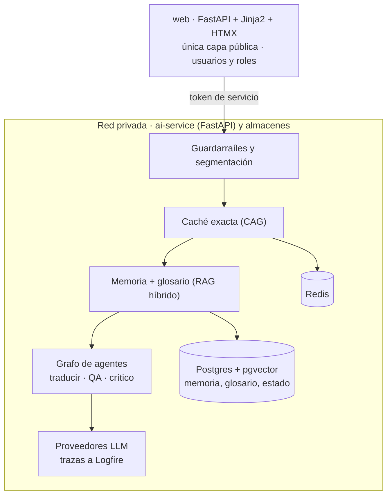

# Propuesta de TFM — Traductor de fútbol consistente con IA

30 de octubre de 2026 · Borja Berrocal

## Resumen de la propuesta

Propongo como trabajo de fin de máster un servicio que traduce contenido de fútbol del español al inglés, al árabe y al chino de forma **consistente**: la misma frase, con la misma configuración, se traduce siempre igual. Debe respetar un glosario validado y no alterar nunca marcadores, minutos, fechas ni nombres de jugadores.

Lo desarrollaré desde cero en un repositorio nuevo, tomando el estimador del máster como guía de arquitectura y patrones. Mi intención es que cada módulo del máster aporte una pieza con una función real en el producto, y no añadir técnicas solo para cubrir el temario.

Calculo unas **10 semanas** de trabajo a tiempo parcial. Con este documento quiero que valides si el planteamiento y el alcance son adecuados para el TFM antes de empezar. Al final dejo las preguntas concretas que necesito resolver contigo.

## Motivación y problema

El contenido de fútbol se publica cada día en muchos idiomas: crónicas, previas, fichas de jugadores, noticias de club. Al traducirlo con herramientas genéricas aparecen siempre los mismos problemas:

- **Inconsistencia:** la misma expresión se traduce de formas distintas en días distintos.
- **Terminología:** el traductor no conoce el vocabulario propio del fútbol ni el estilo de la casa.
- **Nombres:** en árabe y en chino un mismo jugador puede transcribirse de varias formas, y el lector percibe el error enseguida.
- **Datos:** un marcador, un minuto (45+2') o una fecha alterados convierten una noticia en falsa.

El resultado es que alguien acaba revisando todo a mano. Elijo árabe y chino a propósito: son dos escrituras no latinas, una de ellas de derecha a izquierda, y ahí es donde fallan las soluciones genéricas. Eso hace el problema más interesante y la evaluación más exigente.

Creo que es un buen caso para el TFM porque es un problema real, con un criterio de éxito medible (consistencia, glosario, integridad de datos) y que obliga a combinar casi todo lo visto en el máster.

## Objetivos del trabajo

**Objetivo general.** Diseñar, construir, desplegar y evaluar un sistema de traducción con IA para contenido de fútbol que sea consistente, respete la terminología y no altere los datos, aplicando las arquitecturas vistas en el máster.

**Objetivos específicos y cómo los mediré**

| Objetivo                | Criterio de éxito                                                                                          |
|-------------------------|------------------------------------------------------------------------------------------------------------|
| Consistencia            | 100 % de salidas idénticas para la misma entrada y configuración                                           |
| Terminología            | ≥ 95 % de términos del glosario usados correctamente, en cada idioma                                       |
| Integridad de datos     | 0 marcadores, minutos, fechas o nombres alterados en el conjunto de prueba                                 |
| Calidad                 | Igual o mejor que un traductor genérico en mi conjunto de prueba, medido por par de idiomas                |
| Coste y latencia        | Coste por 1.000 palabras y latencia visibles y dentro de los límites que fijo en el apartado de evaluación |
| Decisiones justificadas | Cada elección técnica importante respaldada por un experimento A/B                                         |

No pretendo sustituir al traductor humano: el sistema marca lo dudoso y lo envía a revisión.

## Alcance: qué voy a construir y qué dejo fuera

He recortado el alcance con un criterio: cada funcionalidad debe resolver un problema del producto **y** demostrar un tema del máster. Lo que no cumple las dos cosas se queda fuera.

**Lo que voy a construir**

1. **Traducción consistente** de texto, HTML y JSON de español a inglés, árabe y chino simplificado, con caché exacta por frase y protección de cifras y nombres.
2. **Memoria de traducción** alimentada con contenido de fútbol ya traducido de webs oficiales, con búsqueda híbrida.
3. **Glosario y registro de entidades**: términos de fútbol y jugadores, clubes, estadios y competiciones con su grafía oficial en cada idioma.
4. **Control de calidad** automático: cifras comparadas por valor (también con dígitos árabes y fechas en formato chino), glosario, nombres y tipografía propia de cada idioma.
5. **Grafo de agentes** traductor → control de calidad → crítico, con estado persistente y parada para revisión humana cuando no converge.
6. **Refinamiento conversacional**: el usuario pide cambios ("más informal", "usa *clean sheet*") y el sistema los recuerda durante la sesión.
7. **Interfaz ligera** con cuatro pantallas: traducir, refinar, revisar y glosario.
8. **Guardarraíles, evaluación, A/B y observabilidad**, y despliegue reproducible.

**Lo que dejo fuera, y por qué**

| Fuera de alcance                                                                              | Motivo                                                                                 |
|-----------------------------------------------------------------------------------------------|----------------------------------------------------------------------------------------|
| Más idiomas o variantes regionales                                                            | Tres destinos ya cubren los casos difíciles                                            |
| Otros deportes                                                                                | El fútbol, acotado a una liga, ya da un glosario y un registro de jugadores abarcables |
| DOCX, XLIFF, importación TMX/TBX                                                              | Trabajo de conversión de formatos que no añade temas del máster                        |
| Sugerencias SEO, investigación terminológica automática, localización de tablas de resultados | Interesantes, pero cada una sería un proyecto en sí; las dejo como líneas futuras      |
| Varios clientes, SSO, conector con un CMS real                                                | Aportan complejidad de producto, no de IA                                              |

Una decisión que quiero destacar: **no usaré caché semántica para traducir**, aunque el estimador sí la usa. Devolver la traducción de una frase parecida es un error ("el Betis ganó 2-1" frente a "el Betis perdió 2-1"). Lo demostraré con un experimento en la evaluación.

## Cómo cubre los módulos del máster

He comprobado que cada módulo queda cubierto por al menos una funcionalidad imprescindible del proyecto.

| Módulo                                                        | Qué implemento                                                                                                                                       | Por qué lo necesita el producto                                                         |
|---------------------------------------------------------------|------------------------------------------------------------------------------------------------------------------------------------------------------|-----------------------------------------------------------------------------------------|
| Fundamentos: comunicación con LLMs y APIs                     | Cliente LLM propio con salida estructurada, temperature = 0, modelo fijado, respaldo entre proveedores y registro de coste; prompts versionados      | Sin control fino del modelo no hay consistencia                                         |
| CAG: contexto, conversación, memoria                          | Caché exacta por frase; sesión de refinamiento con memoria de indicaciones y compresión del historial                                                | La caché garantiza la consistencia; la conversación permite ajustar sin reescribir      |
| Data-driven AI: preprocesado, embeddings, BBDD vectoriales    | Rastreo de webs de fútbol, limpieza, alineación de frases es–en–ar–zh con embeddings, carga en pgvector                                              | Aprovecha traducciones ya publicadas como conocimiento                                  |
| RAG: recuperación básica y avanzada, evaluación               | Memoria de traducción con búsqueda híbrida (vectorial + trigramas, fusión RRF, reranker); glosario por coincidencia exacta; métricas de recuperación | Le da al modelo ejemplos y restricciones de cómo traducir en esta casa                  |
| Agentes: grafos, estado, errores, multi-agente                | Grafo LangGraph traductor → control de calidad → crítico, estado persistente en Postgres e interrupción para revisión humana                         | Corrige errores de sentido que las reglas no ven y deja decidir a una persona lo dudoso |
| LLMOps: guardarraíles, A/B, evaluación, observabilidad, coste | Guardarraíl contra instrucciones escondidas en el texto, conjunto de prueba, A/B de variantes, trazas y coste en Logfire, despliegue con CI          | Permite demostrar con datos que funciona y cuánto cuesta                                |

## Arquitectura propuesta

Replico la organización del estimador porque ya resuelve los problemas que aquí reaparecen, pero escribo todo el código desde cero.

arquitectura propuesta · 2 capas, 4 pasos de traducción

- **Dos capas.** Una capa web ligera (FastAPI con Jinja2 y HTMX), que es la única pública, y un ai-service privado con toda la lógica de IA y las claves de los proveedores. El navegador nunca habla con el servicio de IA.
- **Capas internas.** Como en el estimador, las piezas de IA (caché, recuperación, glosario, agentes, conversación) no se importan entre sí y solo se combinan en un conductor, TranslationService. Lo dejaré documentado en un ARCHITECTURE.md propio.
- **Tecnología.** Python, FastAPI, LiteLLM + Instructor, LangGraph, PostgreSQL con pgvector y pg_trgm, Redis, Docker Compose, CI con GitHub Actions y Logfire para observabilidad.

| Patrón del estimador                        | Cómo lo adapto                                                       |
|---------------------------------------------|----------------------------------------------------------------------|
| Caché exacta con SHA-256                    | Por frase, incluyendo idiomas y versión de glosario, prompt y modelo |
| Caché semántica                             | No la uso para traducir                                              |
| Búsqueda híbrida vectorial + texto completo | Vectorial + trigramas, más adecuado para frases casi iguales         |
| Guardarraíl de PII que bloquea              | Enmascara emails y teléfonos y conserva los nombres de jugadores     |
| Grafo LangGraph con estado en Postgres      | Añado la parada para revisión humana                                 |

## Cómo voy a evaluar el resultado

Quiero que la evaluación sea el núcleo de la defensa: cada decisión técnica debe estar respaldada por un número.

**Conjunto de prueba.** 450 frases (150 por par: es→en, es→ar, es→zh) de crónicas, previas y fichas, con traducción de referencia revisada por hablantes nativos, términos esperados y cifras y nombres anotados. Incluye unos 30 casos trampa: frases casi iguales con significado distinto, textos con instrucciones escondidas y frases cargadas de marcadores y minutos.

**Métricas**, siempre por par de idiomas:

| Métrica                                | Objetivo                                         |
|----------------------------------------|--------------------------------------------------|
| chrF (y COMET en una muestra)          | ≥ traductor genérico                             |
| Adherencia al glosario                 | ≥ 95 %                                           |
| Integridad de cifras y nombres         | 100 %                                            |
| Consistencia                           | 100 %                                            |
| Recall@5 de la memoria de traducción   | ≥ 85 %                                           |
| Precisión del crítico                  | ≥ 70 %                                           |
| Resistencia a instrucciones escondidas | 100 % de casos trampa traducidos sin obedecerlas |
| Coste                                  | \< 0,10 USD por 1.000 palabras y idioma          |
| Latencia                               | \< 30 s para una crónica de 500 palabras (p95)   |

**Experimentos A/B que haré**

1. Sin memoria de traducción frente a con memoria.
2. Búsqueda solo vectorial frente a híbrida, con y sin reranker.
3. Con y sin crítico: cuánta calidad añade y cuánto cuesta.
4. Dos modelos para traducir, uno de gama media y otro ligero.
5. Caché exacta frente a semántica en los casos trampa.

## Planificación

Diez semanas. Sigo el orden de los módulos del máster y cada semana termina con algo que funciona y se puede medir.

| Semana | Hito                          | Entregable                                                                                                            |
|--------|-------------------------------|-----------------------------------------------------------------------------------------------------------------------|
| 1      | Esqueleto                     | Repositorio con las dos capas, Docker Compose, Postgres/pgvector, Redis, CI y ARCHITECTURE.md                         |
| 2      | Cliente LLM y datos de prueba | Cliente LLM; glosario inicial (≈ 300 términos), registro de ≈ 500 jugadores y clubes, conjunto de prueba y línea base |
| 3      | Traducción consistente        | Servicio de traducción con caché exacta y protección de cifras; test de consistencia; interfaz mínima                 |
| 4      | Datos                         | Ingesta de webs de fútbol, alineación de frases y carga en pgvector                                                   |
| 5      | RAG                           | Memoria híbrida y glosario en el prompt; primeras métricas y A/B                                                      |
| 6      | Agentes (1)                   | Grafo con control de calidad, crítico y estado persistente                                                            |
| 7      | Agentes (2)                   | Revisión humana dentro del grafo y pantalla de revisión                                                               |
| 8      | Conversación                  | Refinamiento con memoria de sesión                                                                                    |
| 9      | LLMOps                        | Guardarraíles, A/B completos, trazas y dashboard en Logfire, despliegue                                               |
| 10     | Cierre                        | Informe de evaluación, memoria del TFM, demo y margen para imprevistos                                                |

Si voy justo de tiempo, recortaré en este orden: compresión del historial de conversación, reranker, extracción automática de términos, contexto entre frases y tamaño del conjunto de prueba (de 150 a 100 frases por par). Ninguno de estos recortes deja un módulo sin cubrir.

## Riesgos y plan B

| Riesgo                                                                                                            | Plan B                                                                                                                  |
|-------------------------------------------------------------------------------------------------------------------|-------------------------------------------------------------------------------------------------------------------------|
| No encuentro suficiente contenido de fútbol traducido a los cuatro idiomas con condiciones de uso que lo permitan | Lo resuelvo en la semana 1; si falta, completo la memoria con traducciones propias revisadas                            |
| No consigo revisores nativos de árabe y chino                                                                     | Los busco antes de la semana 2; si no aparecen, reduzco el conjunto de prueba de esos pares y lo indico como limitación |
| Un mismo jugador tiene varias transcripciones                                                                     | Tomo como referencia la grafía de la web del club o la liga en ese idioma                                               |
| El modelo rinde peor en árabe y chino                                                                             | Lo mido por par y lo documento; es un resultado válido del trabajo, no un fallo                                         |
| La base técnica desde cero me lleva más de dos semanas                                                            | Uso la estructura del estimador como plantilla de diseño y mantengo la interfaz al mínimo                               |
| El crítico genera falsos positivos                                                                                | Máximo dos iteraciones; si no aporta calidad, se desactiva y lo justifico con el A/B                                    |

## Lo que necesito que me valides

Antes de empezar me gustaría tu opinión sobre estos puntos:

- [ ] **Validez del tema:** ¿es un proyecto adecuado como TFM del máster?
- [ ] **Alcance:** ¿te parece realista en 10 semanas, o recortarías o añadirías algo?
- [ ] **Cobertura del temario:** ¿consideras suficiente cómo cubro cada módulo, sobre todo agentes y LLMOps?
- [ ] **Desarrollo desde cero:** ¿es correcto usar el estimador solo como guía de arquitectura, sin reutilizar su código?
- [ ] **Tres idiomas destino:** ¿mantengo inglés, árabe y chino, o empiezo con dos para reducir riesgo?
- [ ] **Descartar la caché semántica:** ¿te parece una decisión bien justificada?
- [ ] **Evaluación:** ¿son suficientes las métricas y los experimentos A/B para la defensa?
- [ ] **Entregables:** ¿qué espera el tribunal además del código y la demo (memoria escrita, formato, extensión)?

Gracias por revisarlo. Puedes comentar directamente sobre el documento.
