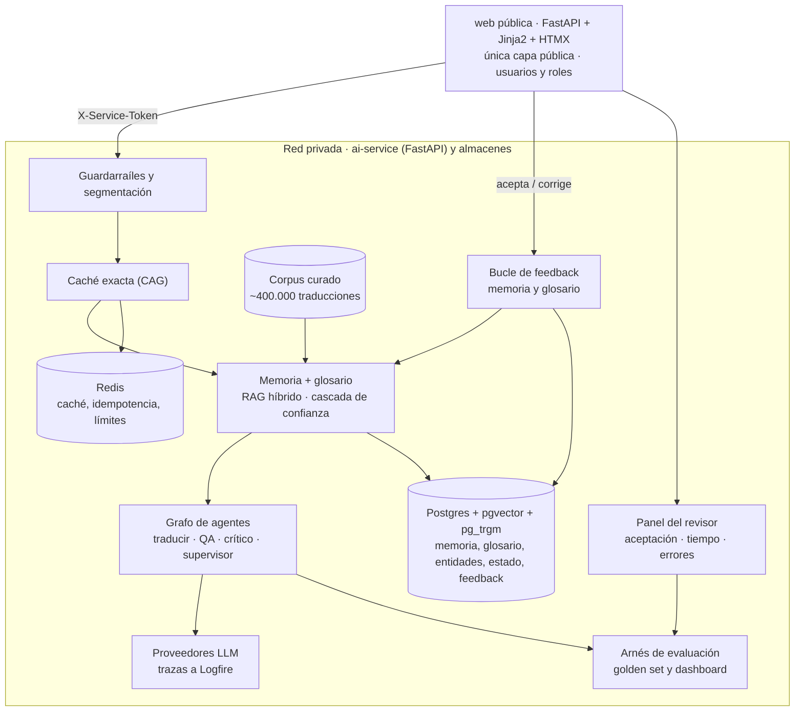

# Servicio de traducción asistida consistente con IA

## Resumen de la propuesta

Propongo como trabajo de fin de máster un servicio de traducción asistida para contenido editorial especializado —texto, HTML, JSON y DOCX— del español al inglés, al árabe y al chino. 

El sistema sugiere, para cada segmento, la traducción ya realizada más fiable del corpus y el traductor la valida o la modifica; cuando no hay una sugerencia adecuada, genera una propuesta. 

La sugerencia se resuelve en cascada —exacta, difusa o generación— con su puntuación de confianza y su procedencia; las correcciones aprobadas alimentan la memoria y un panel mide aceptación, tiempo y errores. 

Todo debe ser **consistente** —la misma frase, con la misma configuración, se sugiere siempre igual—, respetar un glosario validado y no alterar nunca cifras, fechas, unidades ni nombres propios. 

**El objetivo es aumentar la velocidad de traducción actual, que hoy se hace a mano, sin perder el control del traductor.**

Parto de un **corpus inicial de unas 400.000 traducciones ya realizadas**, que usaré como memoria de traducción tras un proceso de curaduría. Eso me permite centrar el TFM en el sistema de IA —recuperación, generación, agentes, evaluación y operación— en lugar de en la recolección masiva de datos.

Lo desarrollaré desde cero en un repositorio nuevo, tomando el estimador del máster como guía de arquitectura y patrones. Mi intención es que cada módulo del programa aporte una pieza con una función real en el producto, y no añadir técnicas solo para cubrir el temario.

Con este documento quiero que el mentor valide si el planteamiento y el alcance son adecuados para el TFM antes de empezar.

## Motivación y problema

Hoy las traducciones se realizan a mano, texto a texto. El equipo dedica tiempo a redactar de nuevo segmentos que ya se tradujeron en el pasado, y cada traductor resuelve los mismos términos de forma distinta. El cuello de botella no es solo la calidad: es la velocidad.

La oportunidad es convertir el corpus de ~400.000 traducciones en una memoria activa. Para cada segmento, el sistema sugiere la traducción ya realizada más fiable y el traductor la valida o la modifica; si no hay una sugerencia adecuada, el sistema genera una propuesta nueva. El objetivo no es sustituir al traductor, sino quitarle el trabajo repetitivo y darle una base fiable sobre la que decidir.

El contenido editorial especializado se publica cada día en muchos idiomas: artículos, informes, fichas de producto y documentación. Al traducirlo con herramientas genéricas aparecen siempre los mismos problemas:

- **Inconsistencia:** la misma expresión se traduce de formas distintas en días distintos.
- **Terminología:** el traductor no conoce el vocabulario propio del dominio ni el estilo de la casa.
- **Nombres:** en árabe y en chino un mismo nombre propio o una misma entidad puede transcribirse de varias formas, y el lector percibe el error enseguida.
- **Datos:** una cifra, una fecha o una unidad alteradas convierten un texto en falso.

Sin una memoria fiable, el traductor acaba reescribiendo lo que ya estaba bien y revisando a mano lo que el sistema no entiende. Elijo árabe y chino a propósito: son dos escrituras no latinas, una de ellas de derecha a izquierda, y ahí es donde fallan las soluciones genéricas. Eso hace el problema más interesante y la evaluación más exigente.

Ese corpus cambia el punto de partida: el problema deja de ser «conseguir datos» y pasa a ser «convertir esos datos en una memoria fiable». La calidad, la alineación, la deduplicación, la licencia de uso y la separación entre memoria y evaluación son ahora parte central del trabajo.

Creo que es un buen caso para el TFM porque es un problema real, con un criterio de éxito medible (consistencia, glosario, integridad de datos y tiempo de traducción) y que obliga a combinar casi todo lo visto en el máster.

## Objetivos del trabajo

**Objetivo general.** Diseñar, construir, desplegar y evaluar un sistema de traducción asistida con IA para contenido editorial especializado que sugiera traducciones ya realizadas, genere propuestas cuando no haya una sugerencia adecuada, sea consistente, respete la terminología, no altere los datos y acelere el trabajo del traductor, aplicando las arquitecturas vistas en el máster.

**Objetivos específicos y cómo los mediré**

| Objetivo | Criterio de éxito |
|---|---|
| Consistencia | 100 % de salidas idénticas para la misma entrada y configuración |
| Terminología | ≥ 95 % de términos del glosario usados correctamente, en cada idioma |
| Integridad de datos | 0 cifras, fechas, unidades o nombres alterados en el conjunto de prueba |
| Calidad | Igual o mejor que un traductor genérico en mi conjunto de prueba, medido por par de idiomas |
| Velocidad | ≥ 30 % menos tiempo de revisión que traducir desde cero, medido en un piloto con traductores |
| Aceptación de sugerencias | ≥ 60 % aceptadas sin cambios o con cambios menores en el piloto |
| Calibración de confianza | La aceptación crece por tramo (exacta > difusa > generación) en el piloto |
| Aprovechamiento del corpus | Memoria construida sobre el corpus curado, con trazabilidad de procedencia y sin fuga hacia el conjunto de prueba |
| Coste y latencia | Coste por 1.000 palabras y latencia visibles y dentro de los límites que fijo en el apartado de evaluación |
| Decisiones justificadas | Cada elección técnica importante respaldada por un experimento A/B |

No pretendo sustituir al traductor humano: el sistema sugiere, marca lo dudoso y deja la decisión final a la persona.

## Alcance

Cada funcionalidad debe resolver un problema del producto y demostrar un tema del máster.

**Lo que voy a construir**

1. **Traducción asistida consistente**: para cada segmento, el sistema sugiere la traducción ya realizada más fiable o genera una propuesta, y el traductor la valida o modifica. Soporta texto, HTML, JSON y DOCX de español a inglés, árabe y chino simplificado, con caché exacta por frase y protección de cifras y nombres.
2. **Soporte DOCX de extremo a extremo**: segmentación de párrafos, tablas, encabezados y notas; preservación de estilos, saltos y numeración; reconstrucción del documento traducido y validación de que no se pierde contenido.
3. **Curaduría del corpus inicial** de ~400.000 traducciones: inventario, deduplicación, filtrado de calidad, normalización, comprobación de alineación, licencia de uso y separación en memoria, validación y prueba.
4. **Motor de sugerencias en cascada**: coincidencia exacta → coincidencia difusa → generación → revisión humana, con puntuación de confianza, procedencia y motivo visibles para el traductor.
5. **Bucle de feedback**: las correcciones aprobadas se incorporan a la memoria de traducción y al glosario, con estado de aprobación y trazabilidad.
6. **Panel del revisor**: aceptación de sugerencias, distancia de edición, tiempo por segmento y términos que más fallan.
7. **Glosario y registro de entidades**: términos del dominio y entidades (organizaciones, productos, personas y lugares) con su grafía oficial en cada idioma.
8. **Control de calidad** automático: cifras comparadas por valor (también con dígitos árabes y fechas en formato chino), glosario, nombres, tipografía propia de cada idioma y consistencia entre segmentos de un mismo documento.
9. **Grafo de agentes** traductor → control de calidad → crítico, con estado persistente, supervisor con permisos mínimos y parada para revisión humana cuando no converge.
10. **Refinamiento conversacional**: el usuario pide cambios ("más informal", "usa un término concreto del glosario") y el sistema los recuerda durante la sesión.
11. **Interfaz ligera** con seis pantallas: traducir, refinar, revisar, glosario, panel del revisor y estado de evaluación.
12. **Guardarraíles, evaluación, A/B, observabilidad y despliegue reproducible**, con un arnés de evaluación que pueda ejecutarse contra el sistema desplegado.

## Flujo de sugerencia y feedback

1. **Coincidencia exacta.** Si el segmento ya existe en la memoria con el mismo contexto, se devuelve tal cual.
2. **Coincidencia difusa.** Si no, se recuperan los segmentos más próximos y se propone el mejor por encima de un umbral de confianza.
3. **Generación.** Si no hay una sugerencia fiable, el modelo traduce con el glosario y los ejemplos recuperados.
4. **Revisión humana.** El traductor acepta, modifica o rechaza. La decisión, el tiempo y la corrección quedan registrados.
5. **Feedback.** Las correcciones aprobadas se incorporan a la memoria y al glosario; el panel mide aceptación, tiempo y errores.

## Corpus inicial y estrategia de datos

El corpus de ~400.000 traducciones es el activo principal del proyecto y, a la vez, su principal riesgo. No lo indexaré tal cual: primero lo auditaré y lo convertiré en un conjunto con procedencia y calidad conocidas.

## Cómo cubre los módulos del máster

He comprobado que cada módulo del programa queda cubierto por al menos una funcionalidad imprescindible del proyecto.

| Qué implemento en el TFM | Por qué lo necesita el producto |
|---|---|
| Cliente LLM propio con salida estructurada, temperature = 0, modelo fijado, respaldo entre proveedores, prompts versionados con Jinja2 y registro de coste | Sin control fino del modelo no hay consistencia |
| Caché exacta por frase; sesión de refinamiento con memoria de indicaciones y compresión del historial; prueba de estrés de la caché | La caché garantiza la consistencia; la conversación permite ajustar sin reescribir |
| Curaduría del corpus de ~400.000 traducciones; segmentación y chunking; embeddings; persistencia en pgvector con índice HNSW y, si procede, *halfvec* | Convierte traducciones ya publicadas en conocimiento recuperable y fiable |
| Memoria de traducción multi-índice (memoria, glosario, entidades); routing de consultas; expansión y descomposición; búsqueda híbrida vectorial + trigramas; fusión RRF; reranker; decaimiento temporal; evaluación con recall@k, nDCG y RAGAS | Sugiere al traductor la traducción ya realizada más fiable y le da al modelo ejemplos y restricciones de cómo traducir en esta casa |
| Cascada de sugerencia con confianza (exacta → difusa → generación → revisión) y explicación de procedencia | Ahorra coste y latencia, y el traductor entiende por qué recibe esa sugerencia |
| Patrón Actor-Critic-Boss; grafo LangGraph con estado persistente en Postgres y checkpointing; interrupción y reanudación para revisión humana; supervisor con permisos mínimos y auditoría de decisiones | Valida la sugerencia, corrige errores de sentido que las reglas no ven y deja decidir a una persona lo dudoso |
| Bucle de feedback: las correcciones aprobadas actualizan memoria y glosario | Reduce correcciones repetidas y mejora la consistencia con el uso |
| Panel del revisor: aceptación, distancia de edición, tiempo por segmento y términos fallidos | Convierte la mejora de velocidad en una métrica operativa |
| Guardarraíles de entrada y salida; golden set y arnés de evaluación por HTTP con puerta de regresión; dashboard de latencia, coste y errores desde los logs; CI/CD; contenedores; despliegue en EC2 con TLS; token de servicio; *health* y *readiness* | Permite demostrar con datos que funciona, cuánto cuesta y cómo se opera |

## Arquitectura propuesta

arquitectura propuesta · 2 servicios, 3 capas conceptuales, cascada de sugerencia y feedback

**Dos servicios, tres capas conceptuales.** Una capa web/pública (FastAPI con Jinja2 y HTMX) que hace de backend de negocio, un ai-service privado con toda la lógica de IA y las claves de los proveedores, y los almacenes. El navegador nunca habla con el servicio de IA.

**Cascada y confianza.** El motor no llama siempre al modelo: primero busca coincidencia exacta y difusa; solo genera cuando la confianza no alcanza el umbral. Cada sugerencia guarda su procedencia, su puntuación y el motivo.

**Feedback y medición.** Las correcciones aprobadas vuelven a la memoria y al glosario; el panel del revisor mide aceptación, distancia de edición y tiempo por segmento.

## Cómo voy a evaluar el resultado

**Métricas de la cascada y del feedback.** Cobertura por tramo (exacta, difusa, generación, revisión), calibración de la confianza (aceptación por tramo), distancia de edición por sugerencia aceptada, tiempo por segmento y porcentaje de correcciones reutilizadas.

**Experimentos A/B que haré**

1. Sin memoria de traducción frente a con memoria; y memoria con el corpus completo frente a una muestra curada.
2. Búsqueda solo vectorial frente a híbrida, con y sin reranker.
3. Índice único frente a multi-índice con routing y expansión de consulta.
4. Con y sin crítico: cuánta calidad añade y cuánto cuesta.
5. Dos modelos para traducir, uno de gama media y otro ligero.
6. Caché exacta frente a semántica en los casos trampa.
7. Corpus con y sin decaimiento temporal (frescura de la traducción).
8. Flujo con sugerencias del corpus frente a traducción manual desde cero (tiempo y aceptación).
9. Cascada (exacta → difusa → generación) frente a generación directa: calidad, coste y latencia.
10. Con y sin bucle de feedback: aceptación, distancia de edición y tiempo a lo largo del piloto.
